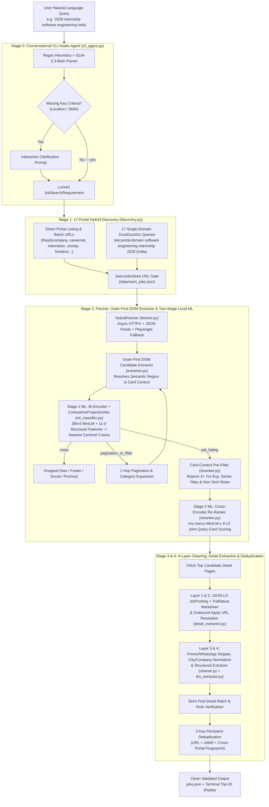
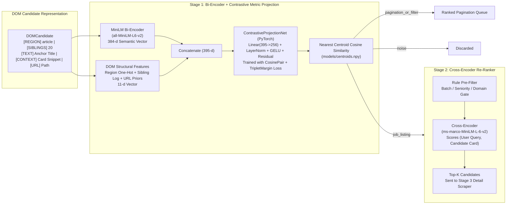
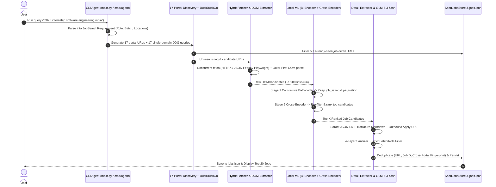

# InterAT — AI-Powered Job & Internship Web Scraper

A clean, modular, next-generation **Job & Internship Web Scraper + Conversational CLI Agent (`glm-5.3-flash`)** across 17 Indian job portals using a **Two-Stage Local ML Pipeline**:

1. **Go Engine (`cmd/agent`, `internal/scraper`):**
   - Interactive CLI Agent & 17-Portal Targeted DuckDuckGo Search + Direct Portal URLs
   - Persistent `SeenJobsStore` (`data/seen_jobs.json`) so jobs from any portal are never re-scraped or duplicated
   - High-speed concurrent HTML fetcher & Outer-First DOM Candidate Extractor (`footer` strictly overrides nested `nav`)
2. **Python ML Layer (`scraper/`, `scripts/`):**
   - **Stage 1 Bi-Encoder (`sentence-transformers/all-MiniLM-L6-v2`):** 384-d embeddings fine-tuned in a **PyTorch Contrastive Pair + Triplet Margin Embedding Space (`ContrastiveProjectionNet`)** and classified via **Nearest Centroid Cosine Similarity** into `job_listing`, `pagination_or_filter`, or `noise`
   - **Stage 2 Cross-Encoder (`cross-encoder/ms-marco-MiniLM-L-6-v2`):** Re-ranks surviving job candidates against the user's exact query + card-context pre-filtering
   - **Stage 3 & 4 Deep Cleaning & Extraction:** `application/ld+json` (`JobPosting`) + `trafilatura` Markdown extraction + 4-layer promo/boilerplate stripper + batched `glm-5.3-flash` structured output into `jobs.json`

---

## Architecture & Pipeline Diagrams

### 1. End-to-End Multi-Stage Scraping Pipeline



### 2. Stage 1 & Stage 2 Local ML Architecture



### 3. Go + Python Hybrid Execution Flow



---

## Quick Start

### 1. Train the Contrastive Pair / Triplet Embedding Space & Generate 2D Vector Plots
```bash
# Train ContrastiveProjectionNet (CosineEmbeddingLoss + TripletMarginWithDistanceLoss)
python3 -m scripts.train_classifier

# Or scrape live portals first to augment the training set with real DOM candidates:
python3 -m scripts.train_classifier --scrape-live

# Generate Side-by-Side Before vs. After 2D Vector Space Plots (plots/vector_space.html & .png)
python3 -m scripts.visualize_vector_space
```

### 2. Run the Interactive CLI Agent (Go + Python Hybrid or Python Entrypoint)
```bash
# Run the Python CLI entrypoint with an initial query:
/opt/anaconda3/bin/python main.py --query "2028 internship software engineering india" --yes

# Or run interactively:
/opt/anaconda3/bin/python main.py

# Or run the Go + Python Hybrid Agent:
go run ./cmd/agent -query "2028 internship software engineering india"
```

### 3. Run the Full Test Suite (Go + Python)
```bash
go test ./... -v
/opt/anaconda3/bin/python -m pytest -v
```
